# NigeriaLife: the first five minutes

Status: built and tested on `claude/next-steps` (2026-11-13). Sections 1 to 5 are the audit and the plan as approved; sections 6 to 8 say what was built, how it tested and what is still open. Not merged, not deployed.

## 1. Audit: what a new player gets today

| Area | What exists | Problem for a first visit |
|---|---|---|
| Start | Splash, title card ("Begin"), then for a guest on the server the sign-up screen, then the look editor opens by itself | Three screens before the first step. Sign-up is asked before the player knows why |
| Spawn | `Game.arriveAtTheGate`: west pavement of Broad Street, Lagos Island, a few steps north of the Victoria Residence Estate gate (about -9.5, 45). Toast "Your gate is ahead" | The player owns no home there, so "your gate" is not true |
| Money | Server account: ₦25,000 cash, ₦150,000 bank (`server/accounts.ts`) | Fine |
| Guide | `src/ui/FirstSteps.ts`: a slim line with 5 steps (name and look, walk, open the phone, take a shift in the Jobs app, collect pay). Ticked by real actions, can be skipped | Mostly phone menus. No people, no place, no home. The first job is found in an app, not in the street |
| Guide persistence | Key `nl_first_steps_v1` in localStorage. It is carried by the account save (CloudSyncService sends every key that is not on the deny list) | A signed-in player on a new device can see the guide flash before the account's copy arrives. No server-side "done" flag |
| People nearby | Story people with actors (greet, wave, shake hands, chat work through `Social.ts`): Chief Alabi the elder (12.5, 20), Mallam Bisi suya (29 m), Chidi the hawker, Alaye at the danfo terminus, Mama Put, the conductor, Sgt. Bello (LASTMA) | They speak only when tapped. Nobody says the next thing worth doing |
| Dialogue | `HUD.showDialogueModal` with reply options and rewards; `Ties` remembers who the player knows | Exists, unused for a first meeting |
| Work nearby | Eko Mega Plaza building site, Supervisor Amaka, 33 m from the spawn. Hire, then carry 6 blocks from pallet to wall (`HandWork`, acted out). Server checks and pays ₦5,000 (Labourer). Port (Foreman Sunday) at 63 m | Ideal first job, but the guide sends the player to the Jobs app instead |
| Homes | Property listings, cheapest the Mushin self-contain; Victoria Residence Estate gate has "Property office" | Not shown to a new player at all |
| Rewards | Server-paid shift, Today's hustle (3 a day), the life ladder, quests (Mainland Hustle etc.) | Fine; the first pay already counts toward Today's hustle and the quest |
| Way-finding | Tap-to-walk from a place card (`PlaceCard.goTo`), minimap, a short-lived property beacon in `World.ts` | No marker that stays on the next person until reached |

## 2. Proposed five minutes (all in the street, no tutorial screens)

| Time | Beat | What the player does | Built from |
|---|---|---|---|
| 0:00 | Arrive | "Begin" on the title and they are on Broad Street in the morning. One line: "Broad Street, Lagos Island. You just arrived with ₦25,000 in your pocket." No sign-up, no editor | Title, arriveAtTheGate (wording fixed) |
| 0:10 | Move | Hint in the slim line: drag the stick (phone) or W A S D (PC). The stick pulses on a phone. Ticks after a few metres | FirstSteps step 2 |
| 0:30 | Someone calls | Chief Alabi, on the pavement ahead, calls "My child! Come, greet your elder." A small marker floats over him, and the line says "Greet Chief Alabi". Tapping him walks the player up and they greet (the animation exists) | Social greet, new marker, new call-out bubble |
| 0:50 | Meaningful talk | Two replies: a respectful "Good morning, sir" (he warms to you; Ties and street credit) or a casual "How far, Chief" (he laughs and teases). Either way he says Amaka at the Eko Plaza site is taking hands today, and that the estate office at the gate lets rooms. Remembered: next time he greets you by name | showDialogueModal options, Ties |
| 1:30 | Find the work | The marker moves to Supervisor Amaka; minimap pin; "Walk there" chip does the walking for a tired thumb | PlaceCard goTo, marker |
| 1:50 | Work | Amaka takes them on; they carry six blocks to the wall, seen in full. The wall really grows | HandWork (exists) |
| 3:20 | Paid | Server pays ₦5,000. Money pill counts up; Amaka: "Come back tomorrow, there is more." This also ticks Today's hustle | Server shift pay (exists) |
| 3:40 | Spend it | If hungry: Mallam Bisi's suya is marked; buy and eat it with the pay | Vendor and visible eating (exist) |
| 4:15 | A home | The marker goes to the estate office at the gate. Its listing opens on what they can afford, cheapest first, with "Show me" on the map. Renting is their choice | Property listing, beacon |
| 4:45 | Keep it | "Keep your life and your ₦5,000 on any phone: choose a name". The sign-up screen opens now, with the name and look; "Later" is allowed | SignInScreen, look editor (moved, not new) |

Free play throughout: any beat can be ignored. The line waits, the marker stays, nothing blocks movement. ✕ skips the rest for good. Doing things out of order still ticks them (a player who finds Amaka first skips the elder's tip).

## 3. Persistence

- Progress keeps using `nl_first_steps_v1`, so it rides in the account save to any device (exists).
- New: a server flag on the account (`onboarded`, set when the guide is finished or skipped, returned by `/me`). A signed-in player on a new device never sees the guide, even before the save arrives. The guide waits for `/me` (or 4 s with no server) before it shows.
- Lives already under way (paid before, or with a home) never get it (exists: `isFreshLife`).
- Reload mid-way: it resumes on the same beat (exists for steps; the beat list keeps that rule).

## 4. Missing systems this needs (small, new)

1. A guide marker: one floating chevron over the next person or door, plus a minimap pin. One mesh, no per-frame cost when hidden.
2. A call-out: a story person speaks first, once, when the player comes within about 12 m (a bubble over the head).
3. A first-meeting conversation for Chief Alabi, with two replies.
4. A server `onboarded` flag on the account.
5. A property listing that opens on "what I can afford".

No new job, currency or reward is invented: the pay is the server's existing site wage.

## 5. Tests planned

New `firstfive` e2e suite: a brand-new life walks the whole five minutes by real actions on desktop keys and on a touch screen; reload at each beat resumes in place; skip is kept; a life under way never sees it; a second browser signed into the same account does not see it (server flag); with the server down the guide still runs and saves locally; the pay is the server's ₦5,000. Then the usual regression suites (ways, plan, streets, touch, drivetouch, phonefit, accountsave, vehicles and the rest) and a frame-count check on the low-end budget.

## 6. What was built (2026-11-12, approved by the user the same day)

Branch `claude/next-steps`. Nothing merged or deployed; the live game stays at `8690f5b`.

### The five minutes as they now play

| # | Line on the screen | What ticks it | Notes |
|---|---|---|---|
| 1 | "Broad Street, Lagos Island. Drag the round stick to walk" (PC: W A S D) | A few metres walked | No sign-up screen and no look editor before the first step |
| 2 | "Chief Alabi is calling you. Go and greet him" | The first conversation with him | He calls out over his head; a gold marker floats over him; "Take me" walks there |
| 3 | "Supervisor Amaka is taking hands today. Ask for work" | Taken on at the site (or the port) | After 6 pm and before 7 am the site is shut: he sends them to Foreman Sunday at the port, which never shuts |
| 4 | "Lay a course: carry the six blocks to the wall" | The first pay | The wall really grows, block by block. ₦5,000 from the server (₦6,000 at the port) |
| 5 | "You have earned it: suya from Mallam Bisi" | Food bought or eaten anywhere, or "Not hungry" | |
| 6 | "Somewhere to sleep tonight: the estate office lets rooms" | The homes list seen, or a home rented | "See rooms" opens the homes they can pay for now, cheapest first. Renting is their choice |
| 7 | "Keep your money and your life on any phone: choose a name" | An account made, or "Play as a guest for now" | Only on a game server, only for a guest |

Rules that hold throughout:
- Every step is ticked by what was really done, in any order. The line shows the first thing not yet done; steps done out of order stay done.
- Nothing is blocked. The line has the distance, an arrow for the direction, and one button; ✕ ends the guide for good.
- The line is hidden while a window is open, at the wheel, on the map and on the title.

### Chief Alabi (`src/world/ChiefAlabi.ts`)

- Greeting him is the main action on his card. Greeted, he asks "Who are you, and what brought you to Lagos?" with a place to type a name and three ways to answer (respectful, street, guarded).
- The name typed is the player's name from then on (the old "name and look" step is gone; the look editor is offered after sign-up, as before). Given no name, he gives them the one they came with.
- He answers differently to each reply, and what he says about work and a roof is true of that player at that hour (site open or shut, already paid or not, has a home or not).
- He remembers: his card quotes the first meeting, he calls out to them by name when they pass (at most once in four minutes), a later greeting gets a different conversation, and each meeting warms the tie with him (`Ties`). The memory is in the life's save and travels with the account.
- He gives advice only. No money or street credit comes from the conversation.

### Sign-up after the first pay

- A guest still in the guide is not shown the sign-up screen at the start. The guide's last step offers it, with the name they gave Chief Alabi already in the username box.
- The title screen has "I already have an account" for a guest on a game server (first-visit card and the continue card). It opens the same screen on Sign in.
- Registering turns the guest into the account in place (same account id, same wallet), then sends the life up (existing `upgrade` path). Signing in replaces the guest life on that device with the account's and never uploads the guest (existing `login` path; the words on the screen now say so).
- A guest whose guide is over is offered the screen when they come back, as before this work.

### Kept on the server

- New table `guide` (account, state `done` or `skipped`, when). `GET /me` returns `guide: open | done | skipped`; `POST /me/guide` sets it once. Nothing a device sends can open it again or change how it ended.
- The game asks the server before the guide is ever drawn, and also waits for the account-save check (`CloudSyncService.decided`), so a device that is about to load the account's newer copy shows nothing first. If the server has not answered in 6 seconds the guide runs on the device's own record; a late answer of "over" takes it away.
- Ended while offline: kept on the device and told to the server the next time it answers.
- An account from before this was kept, whose life is already under way, is marked done the first time the game sees it.
- Progress within the guide (which steps are ticked) is in the life's save, key `nl_first_steps_v1`, so it rides in the account save.

### Reused, not rebuilt

Hiring, the block work, the wall, the pay, payslips and PAYE (`HandWork`, `Employment`, server `/work/*`); greetings (`Social`); the conversation window (`HUD.showDialogueModal`); speech bubbles (`Actor.say`); street vendors; the phone's Property app (one new filter, "I can afford"); the sign-up screen; the account save. The estate's "Property Office" button now opens the phone's Property app instead of the old economy window.

### New pieces

| Piece | File |
|---|---|
| The guide (rewritten in place) | `src/ui/FirstSteps.ts` |
| Chief Alabi's conversation and memory | `src/world/ChiefAlabi.ts` |
| The marker (one unlit 8-triangle mesh, hidden when not needed) | `src/world/GuideMarker.ts` |
| Server flag | `server/store.ts`, `server/game-server.ts` |
| Tests | `tests/e2e/onboarding.mjs` (rewritten), `tests/e2e/firstfive.mjs` (new) |

### Not built from the plan

- The minimap pin: the minimap only exists while driving, so on foot the line carries the distance and a direction arrow instead.
- The money pill does not count up at the pay; the existing pay toast and the pill's new figure are what is seen.

### Found and fixed along the way

| Found | Where | Fix |
|---|---|---|
| "Take me" from Amaka's site back to Chief Alabi stopped 30 m short in 2 runs of 3 | The walker moved on to the next point of its way from up to 0.45 m short of a corner, brushed a scaffold post on Broad Street, stepped round the wrong side into a dead end and gave up | `Player.ts`: a corner is cut only where the line ahead is clear by a walker's width, and a walk brought up short far from its goal has its way found again (twice at most). 4 runs of 4 arrive; from the dead-end spot itself it now finds the way |
| While the blocks went down the screen could be mostly grey | Arriving from Chief Alabi the camera follows from the north, where it stands over a floor of the unfinished building; the slab hid the wall | The site turns the view to the open side of the yard when the course starts (the hook places already had for the camera) |
| The guide vanished after the first pay | A server rule of mine: "an account with a payslip is past the guide". The first pay is part-way through it | Rule removed; old accounts are marked done by the game when it sees a life under way |
| A guide skipped while offline was only told to the server after the title was closed, and the sign-up screen sits over the title for that guest | Order of screens | Told as soon as the server answers, whatever is on the screen |
| The username offered at sign-up for "Wasiu" was "Wa_iu" | A lost backslash in a pattern | Fixed; the server suite checks the offered name |
| A street toast could cover Chief Alabi's words on a phone | Toasts are drawn over conversations | While someone is speaking, toasts sit at the top of the screen |

### Pictures (316 px wide phone screen, taken from the running build by the walk-through script)

| | | |
|---|---|---|
| 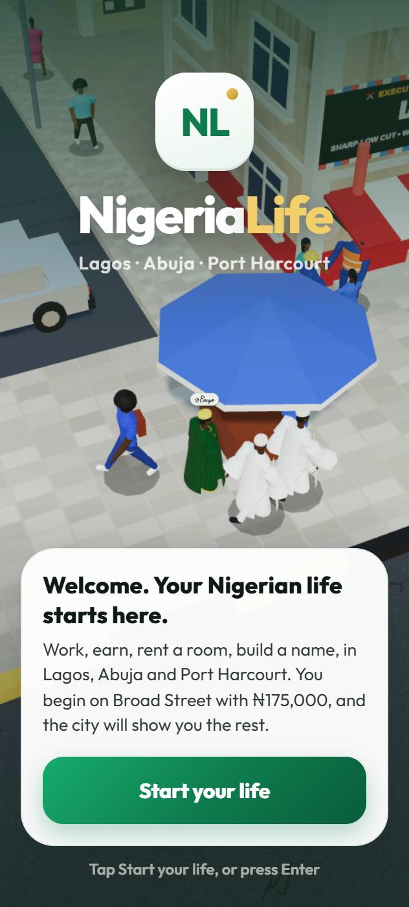 | 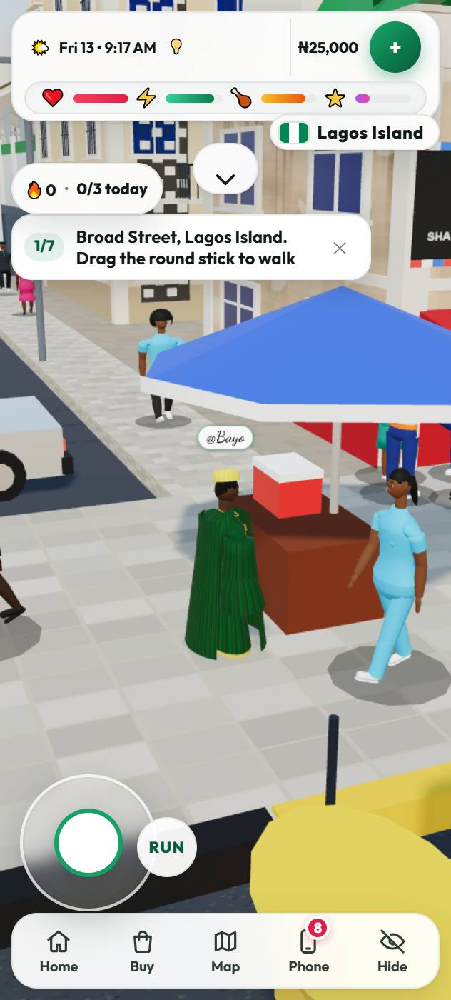 | 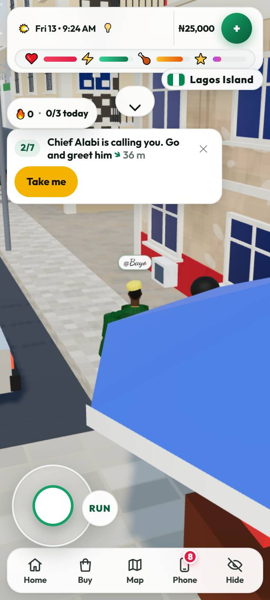 |
| First visit | In the street at once | The line, the distance, the arrow, "Take me" |
| 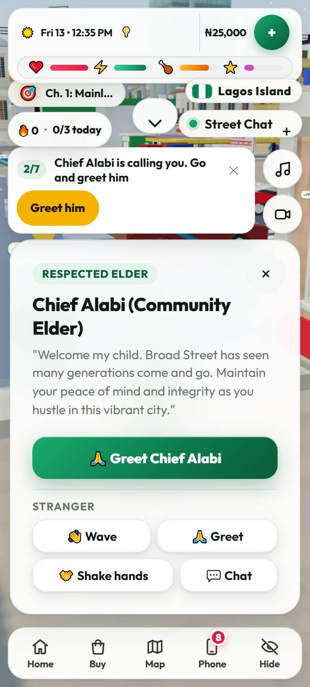 | 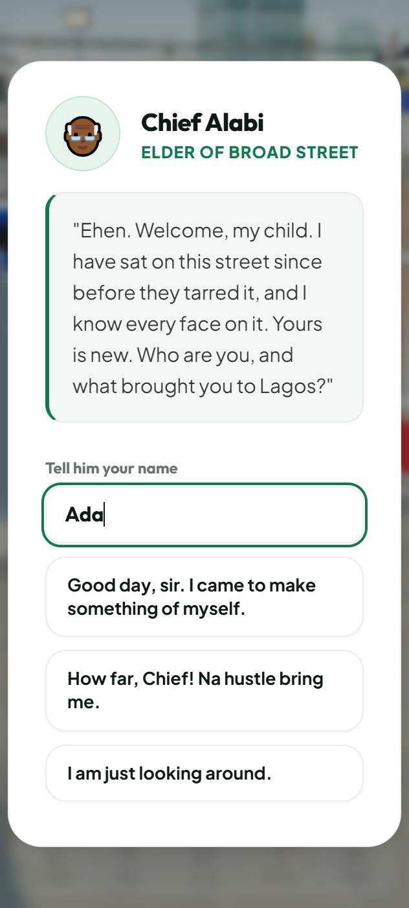 | 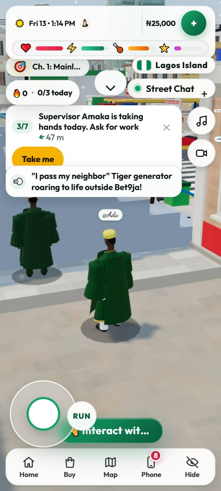 |
| His card | His question, a name, three ways to answer | The work he spoke of |
| 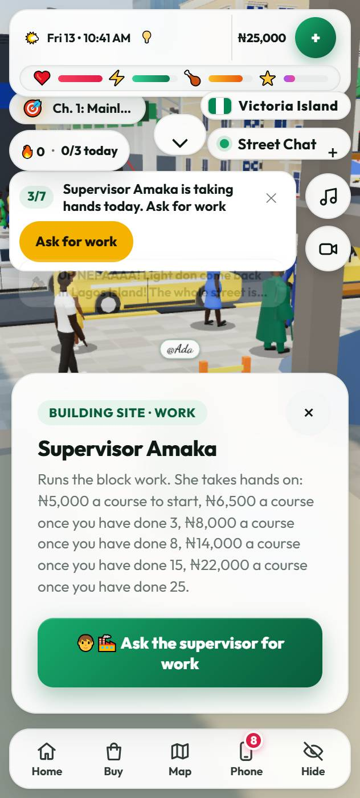 | 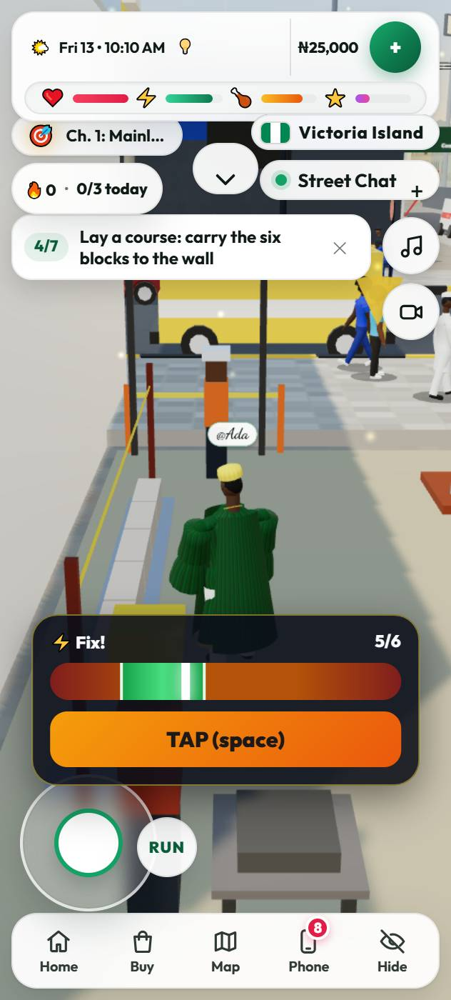 | 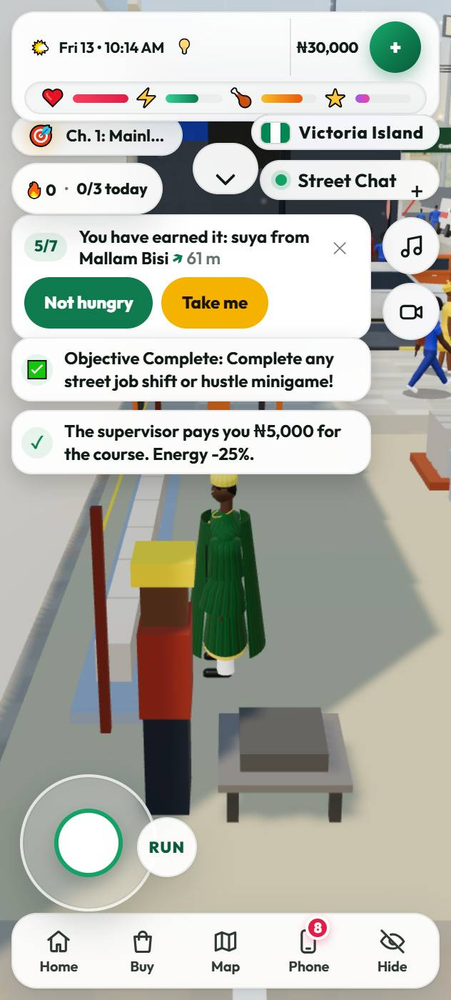 |
| Supervisor Amaka | Blocks going down | The course laid, ₦5,000 paid |
| 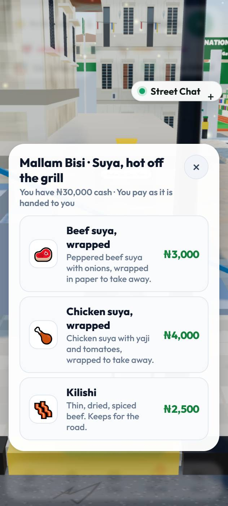 | 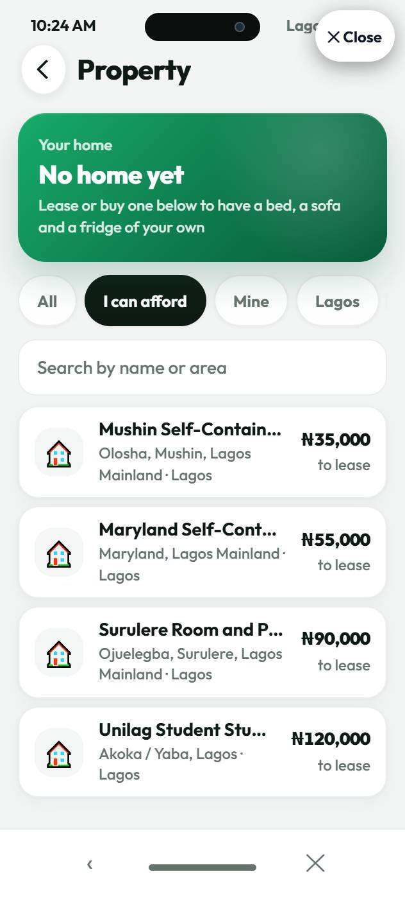 | |
| Mallam Bisi | The homes they can pay for, cheapest first | |

These were taken without a game server, so the sign-up step is not among them. That step is covered by the `firstfive` suite. There are no pictures or recordings from a real phone.

## 7. Test results

All runs are headless Chrome on the development laptop against a frozen build. Nothing here was run on a real phone.

### The two first-five suites, on the final build

| Suite | What it plays | Result |
|---|---|---|
| `onboarding` | A 316 px touch screen, real taps, no game server | 26 of 26 |
| `firstfive` | 1280 px, keyboard and mouse, a real game server started for the run | 22 of 22 |

How the cases asked for are covered:

| Case | Where | What is checked |
|---|---|---|
| Brand-new account, touch screen | `onboarding` | Title, straight into the street, the stick, Chief Alabi (name typed, reply chosen), Amaka, the course (wall 0 to 6 blocks), ₦5,000, suya bought, the rooms list, the end |
| Brand-new account, keyboard and mouse | `firstfive` | The same with W, mouse clicks, and replies picked with 1 and E; a name containing W, A and S is typed without the player walking |
| The pay is the server's | `firstfive` | A ₦5,000 payslip from the Eko Mega Plaza site in the account; the server's wallet up by the slip's net; the game shows the server's figure |
| Reloading at every stage | both | Loaded again at: Chief Alabi, ask for work, lay the course (`onboarding`); something to eat, a room, keep it (`firstfive`). Each time the same step comes back. The first step (walking) is not reloaded on its own |
| Skipping, for good | both | ✕ removes the line and the marker; still gone after a reload; the server holds `skipped`; with the device's own record wiped the guide still never shows; the server refuses to reopen it |
| Completion, for good | both | Gone after a reload; the server holds `done` |
| Existing account on another device | `firstfive` | A second browser signs in from "I already have an account". A watcher installed before the page loads confirms the guide's line never existed there, nor the sign-up screen |
| Guest to account | `firstfive` | Same account id before and after, same wallet, and the server's saved life has the name, the job done, the guide over and Chief Alabi's memory |
| An account is not overwritten by a guest | `firstfive` | After the second browser (which began as a new guest) signs in, the account's save still has the job done and the name, at the same or a later version, with the same money |
| Server unavailable | `firstfive` | With the server stopped the page loads and the guide carries on from the same step; skipped offline, it is told to the server when the server is back |
| Another order | `onboarding` | Straight to Amaka first: taken on, the line only suggests Chief Alabi, and once he is greeted it goes to the course, not back to asking for work |
| At night | `onboarding` | At 9 pm he sends them to Foreman Sunday; taken on, the lorry loaded, ₦6,000 paid |
| A life already under way | `onboarding` | Paid before, no record of the guide: offered Continue, never sees it |
| The view while working | `onboarding` | While the blocks go down the camera is not over the unfinished building |

Failures on the way, all fixed and re-run (see "Found and fixed" above): the guide ending at the first pay; the offline skip not reaching the server; the walk stalling by the post; the offered username; one navigation timeout on a reload under load that did not recur.

### Regression, on the final build

29 suites, 611 of 611 checks:

| Suite | Result | Suite | Result | Suite | Result |
|---|---|---|---|---|---|
| onboarding | 26/26 | firstfive | 22/22 | accountsave | 23/23 |
| access | 11/11 | bigcities | 9/9 | buka | 35/35 |
| citylife | 8/8 | home | 22/22 | hours | 19/19 |
| input | 21/21 | jobs | 16/16 | kerbs | 11/11 |
| landmarks | 26/26 | money | 15/15 | needs | 9/9 |
| online_api | 50/50 | phone | 39/39 | phonefit | 28/28 |
| places | 28/28 | quests | 17/17 | saves | 24/24 |
| self | 24/24 | server | 17/17 | shop | 37/37 |
| social | 24/24 | today | 10/10 | touch | 10/10 |
| ways | 20/20 | workplaces | 10/10 | | |

Four more suites passed on the build before the last two small changes (the site's camera, the toast position) and were not run again after them: plan 17/17, streets 16/16, sidestreets 5/5, getabout 9/9.

Not run for this milestone: the other 81 suites in `tests/e2e/run.mjs` (driving, vehicles, flights, hotels, interiors, politics, the phone's other apps and so on). The full list takes several hours on this machine. So this is a regression of the systems the work touches, not of the whole game.

### Performance (counted, not timed: the laptop is busy)

Same build, 316 px screen, standing at the spawn:

| | Guide off | Guide on (line and marker) |
|---|---|---|
| Draw calls | 513 | 513 |
| Triangles | 189,735 | 189,931 (people walking past; the marker is 8) |
| Shader programs | 55 | 55 |
| Textures | 32 | 32 |

The guide's own check runs twice a second and took 0.58 ms each time on the laptop. The line is redrawn only when its words change. The previous build at the same spot: 511 draw calls, 192,271 triangles, 55 programs. Frame rate on a real low-end Android phone was not measured.

## 8. Still outstanding

- Nothing has been tried on the Galaxy A16. To check there: the line's size and place, typing a name with the on-screen keyboard open, "Take me" walks, the view while laying blocks, and how it feels in the evening (the port).
- No recording; pictures are from the headless browser only.
- A second browser signing in while the first is still open and connected does not finish (known from before this work). The second-device test closes the first browser first.
- Chief Alabi has one first conversation and one kind of later conversation. He does not yet react to bigger events in the player's life (a home, a car, a title).
- The first five minutes exist only in Lagos. A life that somehow begins in Abuja or Port Harcourt gets the line without a marker or "Take me".
- The marker cannot be seen through buildings; the arrow on the line gives the direction instead. There is no minimap on foot.
- Mallam Bisi's suya is sold wrapped (it goes in the bag), so buying it does not show the player eating.
- The rent shown is the listing's lease price (from ₦35,000); nothing in the guide explains weekly rent after that.
- The on-foot camera can still stand over the unfinished building's floors when the player is not working (walking beside the site with the view from the north).
- The walker fix changes how every on-foot route is followed (corners are cut less). `ways`, `streets`, `sidestreets`, `getabout`, `plan` and `touch` pass; routes outside those suites were not walked.
